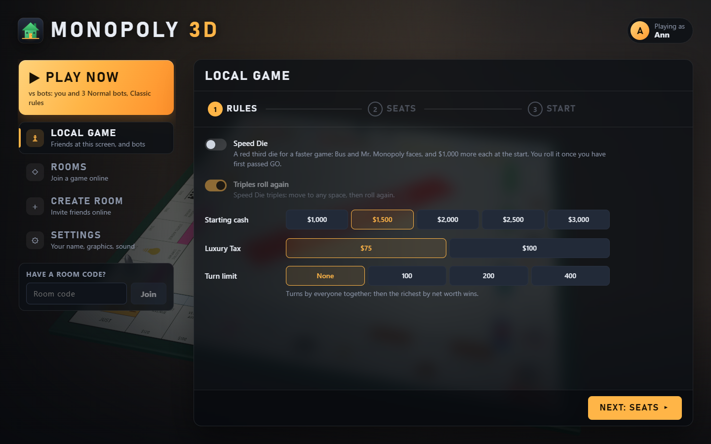
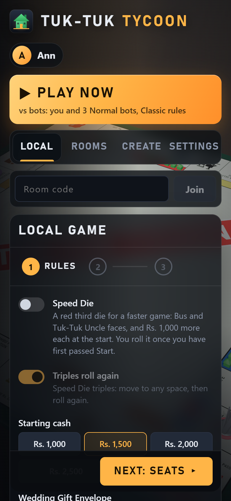
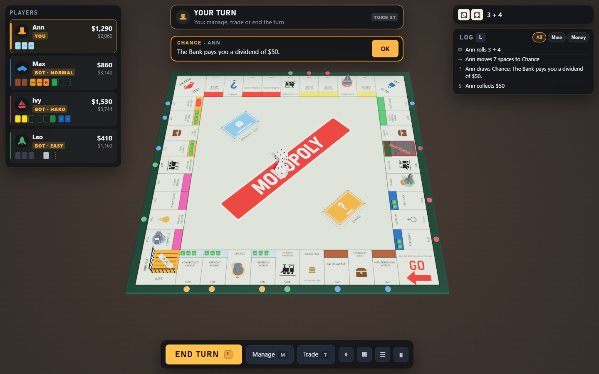
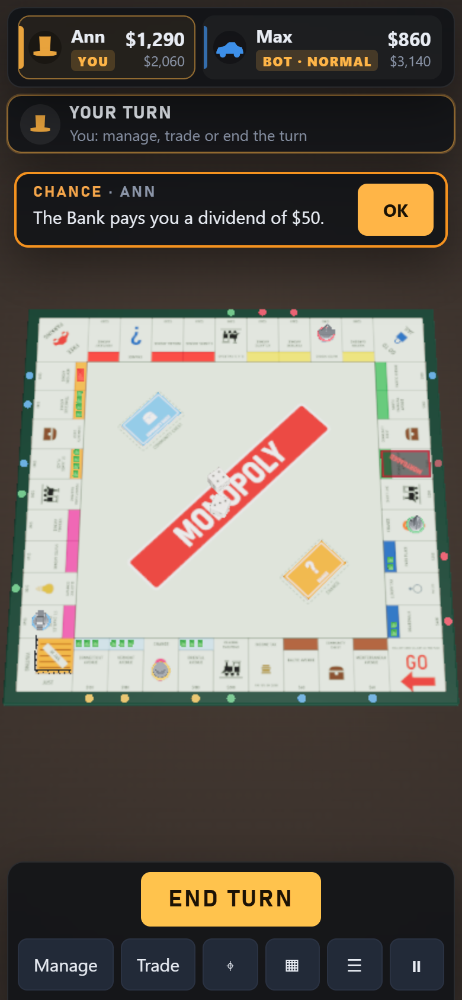
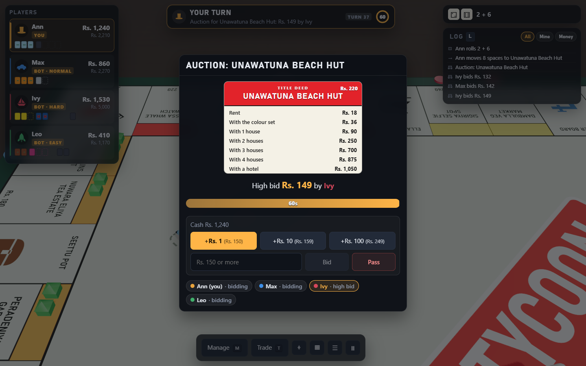
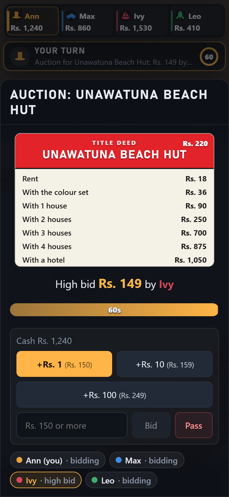

<p align="center"></p>

# Tuk-Tuk Tycoon

A light-hearted Sri Lankan property-trading board game in the browser, on a 3D board built with **React Three
Fiber**, with the optional **Speed Die**. Buy Pettah pavements and Galle Face penthouses, dodge the Inland Revenue,
pray the astrologer is in a good mood, and bankrupt your cousins in rupees. Play against bots offline with no account
and nothing to set up, pass one screen round the table, or open an online room (2 to 8 seats, bots welcome) synced
over **Firebase Realtime Database**, from an invite link or a Discord voice channel.

The rules are the classic 2007 property-trading rulebook (with the Speed Die), unchanged; only the names, card texts
and currency are themed. One board, **Hero League**, plays rules of its own: superheroes saving a city, with
superpowers and no bankruptcy ([docs/heroes.md](docs/heroes.md)). The rules live in a pure TypeScript engine
(`src/rules`) that every client runs on the same JSON state; the 3D scene only shows what the engine decided, and every
action is also a plain DOM button, so the game plays without WebGL too.

## Theme

Each board is one folder, `src/boards/<board>/`: its spaces, cards, size, player cap and standard rules, its tokens
(shapes and icons), its bots' names and its sounds (see `src/boards/README.md`). Five boards, picked when a room or
local game is set up (the Board cards at the top of the rules):

- **All Island** (`src/boards/lanka/`, the default, described below): the whole island in one lap, 40 spaces.
- **Colombo** (`colombo/`, 32 spaces, 2–4 players): Pettah Market Lane up to a Galle Face Sky Suite; Fort, Maradana, Kompannavidiya and
  Bambalapitiya stations; the Load Shedding and Low Pressure Water Boards; Rush Hour and Office Seettu decks.
- **Hill Country** (`hill/`, 36 spaces, 2–6 players): Gampola Bazaar up to Little England Mansion; Kandy, Nanu Oya, Haputale and Ella
  stations; Mountain Mist and Tea Tin decks.
- **Down South** (`south/`, 48 spaces, 2–8 players): Hambantota Salt Pans up to Bentota Beach Palace; Hikkaduwa, Galle, Weligama and
  Matara stations; Lucky Wave and Fishermen's Kitty decks.
- **Hero League** (`heroes/`, 28 spaces, 2–6 players): Midtown Back Alleys up to League Tower, sixteen locations held
  by eight villains; Villain Strike and Hero HQ decks. Its rules are its own (below).

**Hero League** is an original parody of a superhero edition's rules, with every hero, villain, place and card our
own. Each player is one of six heroes (the board's six tokens: Jade Titan, Star Captain, Steel Ace, Storm Lord,
Velvet Viper and Sharpshot), each with a once-per-lap superpower: swap two heroes' places, say no to a villain's
attack, borrow another hero's superpower, demand a re-roll of any throw, move up to 6 extra spaces, or draw two
Villain Strike cards and play one. Money is **Power** (`1,500 Power`). Land on a villain-held location and you must
save it if you can pay; if you can't, a back-up hero who can saves it instead (the **Hero die**, whose faces are the
six heroes, picks one when several can). Short of Power, you pay what you have and nobody goes bankrupt. The game ends
the moment every location is saved: the highest score (Power plus 100 a location) wins. Re-rolls and shields are
asked for in short **reaction windows** (8 s online, 6 s on one screen; a setting can keep them to your own throws).
Speed Die, houses, auctions, mortgages, trades and taxes are not part of it, so the rules form hides those options
there. The full rules: [docs/heroes.md](docs/heroes.md).

The All Island board:

- **Money**: Sri Lankan rupees, shown as `Rs. 150,000` (changes as `+Rs. 20,000` / `−Rs. 35,000`). Everyone starts
  with Rs. 150,000. The rules engine counts the rulebook's amounts (start 1500, prices 60 to 400); every amount
  shown or typed is that times 100 (`display.currency.scale` in the data file, applied by `formatMoney`/`toUnits`).
- **Corners**: **Start** (collect Rs. 20,000 salary as you pass), **Police Station Bench** (just visiting, or held
  there), **Free Tuk-Tuk Stand** (nothing happens) and **Caught Without a Helmet** (go straight to the bench).
- **Colour groups**: Brown: Pettah Pavement, Maradana Lane. Light Blue: Kottu Street, Hoppers Corner, Kiribath
  Junction. Pink: Negombo Fish Market, Pinnawala Elephant Walk, Arugam Bay Surf Shack. Orange: Peradeniya Gardens,
  Nuwara Eliya Tea Estate, Horton Plains Viewpoint. Red: Mirissa Whale Watch, Unawatuna Beach Hut, Galle Fort
  Ramparts. Yellow: Sigiriya Selfie Spot, Dambulla Veg Market, Kandy Lake Promenade. Green: Bambalapitiya Flats,
  Havelock Town, Rajagiriya Highrise. Dark Blue: Cinnamon Gardens, Galle Face Penthouse.
- **Stations** (rent Rs. 2,500 / 5,000 / 10,000 / 20,000 for 1 to 4 owned): Colombo Fort Station, Kandy Station, Ella Station,
  Galle Station.
- **Boards** (the two utilities, 4× or 10× the dice): Power Cut Board and Water Board.
- **Taxes**: **Inland Revenue** (Rs. 20,000 or 10% of your worth) and **Wedding Gift Envelope** (Rs. 7,500).
- **Card decks**: **Astrologer's Advice** (the rulebook's Chance deck) and **Seettu Pot** (its Community Chest), 16
  cards each, from "a cat crossed your path, go back 3 spaces" to "your aunty in Dubai sends a gift".
- **The Speed Die**: 1, 2, 3, Bus and two **Tuk-Tuk Uncle** faces.

## Screenshots

| | Desktop (1440×900) | Phone (390×844) |
|---|---|---|
| The lobby |  |  |
| A drawn card, houses and a hotel on the board |  |  |
| An auction, the bots bidding |  |  |

## Quick start (offline, nothing to set up)

Requires Node 22.12 or newer (CI and Netlify use Node 22).

```bash
npm install
npm run dev           # http://localhost:5173
```

Pick a name, then press **Play now**: you and three Normal bots, Classic rules. No Firebase project, no `.env` and
no Java are needed. The game is saved in the browser after every move: after a reload, or leaving through the menu,
**Continue solo game** in the lobby picks it up at the same move. **Local game** sets up your own table: the rules,
then the seats (more players taking turns at this screen, and bots at any level).

Without a database the lobby's **Rooms** and **Create room** views say "Online play needs a Firebase project — see
README": that is the next section.

## Online rooms

### On this machine: the database emulator

The Firebase Realtime Database emulator runs locally and needs no account, but it needs **Java 21** (`java -version`
to check; CI uses Temurin 21).

```bash
npm run emulator      # terminal 1: a local Realtime Database on :9000 (project demo-tuktuk)
npm run dev:emu       # terminal 2: the game on http://localhost:5173, talking to the emulator
```

Open the game in two browser windows (or a normal and a private one, so they are two players), create a room in one
and join it from the other with the room code or the invite link. `dev:emu` is `vite --mode emulator`, which reads
`.env.emulator` (`VITE_FIREBASE_EMULATOR=true`).

### Using a real Firebase project

1. Create a project at https://console.firebase.google.com.
2. **Build → Realtime Database → Create database**, picking the location closest to your players (it can't be
   changed later). Start it locked; the rules come in step 5.
3. **Project settings → Your apps → Add app → Web**, then copy the config values.
4. `cp .env.example .env` and fill them in. `VITE_FIREBASE_DATABASE_URL` is the one that switches online play on:
   `https://<project>-default-rtdb.firebaseio.com`, or `https://<project>-default-rtdb.<region>.firebasedatabase.app`
   outside the US. These values are not secrets (they end up in the page); the database rules are what protect it.
5. Load `database.rules.json` into the database: paste it into **Realtime Database → Rules** and publish, or with the
   CLI:
   ```bash
   npx firebase login
   npx firebase use --add          # pick your project, alias "default": it replaces demo-tuktuk in .firebaserc
   npm run deploy:rules            # firebase deploy --only database
   ```
   `.firebaserc` ships with `demo-tuktuk`, the emulator's demo project. The emulator scripts pass `--project demo-tuktuk`
   themselves, so pointing `.firebaserc` at your project doesn't change them.
6. `npm run dev`. **Rooms** and **Create room** now work. `npm run build` gives a static `dist/` you can host anywhere
   (see [Deploying](#deploying-netlify)).

To play with others on your LAN while developing, run `npm run dev -- --host` (with a real project; the emulator
setup only listens on 127.0.0.1).

### Deploying the database rules from CI

`.github/workflows/database-rules.yml` handles the rules:

- **On every pull request and push that changes them**, `npm run test:rules` starts the emulator and checks
  `database.rules.json` against writes the game makes (must be allowed) and writes a broken or cheating client would
  try (must be refused).
- **On a push to `main`** (or a manual run from the Actions tab), once the tests pass, it deploys the rules to the
  project in `.firebaserc` with `npm run deploy:rules`. Deploys run one at a time.

One-time setup:

1. Point `.firebaserc` at your project (above).
2. In Google Cloud (**IAM & Admin → Service accounts**, same project as Firebase), create a service account with the
   **Firebase Realtime Database Admin** role, and add a JSON key to it.
3. On GitHub, **Settings → Secrets and variables → Actions**, add the key's whole JSON as `FIREBASE_SERVICE_ACCOUNT`.
   The deploy job runs in the `production` environment, so you can also put the secret there and require an
   approval before each deploy.
4. If a deploy fails with a permission error about checking enabled APIs, also give the account the **Service Usage
   Consumer** role.

## How to play

### The lobby

The lobby is a game-style main menu over the board, which turns slowly behind it (a still frame on low quality, with
reduced motion and on touch screens).

- **Your name** is asked for on the first visit and kept in this browser (`tuktuk-name`); change it in **Settings**.
  Names are 2 to 16 letters, digits, spaces, `-` or `_`.
- **Play now**: you and three Normal bots, Classic rules. **Continue solo game** appears when one is saved (starting
  a new one replaces it).
- **Local game**: three steps, **Rules → Seats → Start**. Seats are you, more players at this screen (**Add a
  player**) and bots (**Add a bot**, each with its level), 2 to 8 in all (as many as the board seats), each with a
  token and a colour of its own (on Hero League the token is your hero, its superpower shown under the picker).
  With two or more people at one screen, a **Pass to *name*** card hides the next player's choices until they say
  they're ready (it can be turned off in the game menu's Settings).
- **Rooms**: every open public room as a card (name, code, host, seats taken, Speed Die, waiting or playing) with
  **Join** for a waiting room, **Watch** for a running game, or **Rejoin** for one this browser holds a seat in. The
  search box filters them. **Room code** in the menu joins any room, listed or private.
- **Create room**: **Rules → Seats → Launch**: the rules, how many seats (2 to 8, at most the board's own cap), its
  bots and your token, then the room's name and whether it is listed.
- **Settings**: see [Settings](#settings).
- **Invite links** (`…/?room=CODE`, or `#CODE`) show "Joining room CODE…" with a two-second countdown, **Join now**
  and **Stay in the lobby**; someone without a name yet picks one first. A room that has closed says so.
- **Coming back**: a reload while in a room goes straight back in as the same player. Rooms this browser holds a
  seat in show a banner ("Your game in ABCDE is still running — Rejoin") for a week.

**The waiting room** shows the seats, with an online dot for each player, your token, the rules and a **Copy invite**
box (on phones it opens the share sheet). The owner adds, changes and removes bots, removes players, edits the rules
and presses **Start game** once two seats are filled; everyone else sees "Waiting for *owner* to start". Once every
seat is taken, newcomers watch. A board too small for the table can't be picked; a new board gives every seat a token
of its own set (none twice) and caps the room's seats at its size. Bots on Hero League get a random free hero.

### A turn

1. **Roll** (`R`), the big button over the middle of the board. The dice tumble, your token hops round the board and the space does what it does: a card flies up
   from its deck, rent is paid automatically, a tax or Start salary shows as a floating "+Rs. 20,000" / "−Rs. 35,000".
2. Land on a property the bank owns and a card over the middle of the board offers **Buy for Rs. X** (`B`) or
   **Auction** (`A`). A Title Deed shows what you'd be buying. Short of cash, **Raise Rs. X** opens Manage.
3. Doubles roll again; three doubles in a row go to the Police Station Bench.
4. **End turn** (`E`), in the same spot as Roll.

Decisions only appear once the board has caught up (the Buy prompt comes after the token lands), and buttons stay
disabled while a move is being committed. A move the rules refuse shows the engine's own reason as a toast.

### Controls

| Input | Action |
| --- | --- |
| `R` | Roll (in jail: roll for doubles) |
| `E` | End turn |
| `B` | Buy the property you landed on |
| `A` | Don't buy it: send it to auction |
| `M` | Manage: build, sell, mortgage |
| `T` | Trade |
| `L` | Open or close the event log |
| `C` | Recenter the camera (and turn automatic framing back on) |
| `V` | Switch the board between the 3D and 2D (top-down) views |
| `N` | Mute: turns the sound effects and the music off, and the second press back to how they were |
| `Esc` | The game menu; closes the dialog on top |
| Drag | Turn the camera (touch: one finger); in the 2D view, pan |
| Wheel | Zoom (touch: pinch) |
| Right drag | Pan (touch: two fingers) |
| Click a space | Its Title Deed or what it does, who owns it and who stands on it |

Shortcuts don't fire while a dialog is open or a text field has focus, and never with Ctrl, Alt or Cmd held, so
browser keys keep working. Moving the camera by hand pauses the automatic framing (overview, following a move,
focusing a tile) until Recenter. When a space must be picked (Speed Die triples), the list takes the arrow keys,
Page Up / Page Down (ten spaces), Home / End, Enter, and typing a name to jump to it.

### The game screen

The board has the whole middle of the screen: the panels keep to the two sides.

- **Turn bar** (tablets and phones; on a desktop the players panel shows whose turn it is, with the turn number, the
  Speed Die badge and the timer in its header): whose turn it is, what the game is waiting for, the running timer and the Speed Die badge.
- **Players** (left): each player's token, name, cash (counting along with the board), net worth (a setting), and
  their property as swatches by colour group (mortgaged ones hatched, houses as pips); online, a dot says whether
  each player is connected. A swatch opens its deed.
- **The middle of the board**: **Roll** or **End turn** (or the jail choices) on your turn, and the decision that's
  up for you (buy or auction, Inland Revenue, the Bus, a triple's space, placing a building, received mortgages, a
  debt), centred in the space the panels leave free. A drawn card flies up in 3D in front of the camera (its words
  are in the log); without the 3D board it shows as a card over the 2D board.
- **The right-hand panel**: the last throw in words, an auction you're only watching, trade offers, and the event
  log (filters **All**, **Mine**, **Money**; its chevron folds it to its header, remembered in this browser, and
  `L` or the Log button shows it again).
- **Action bar** (bottom right, under the log): **Manage**, **Trade**, Recenter, the **2D / 3D** switch (the board
  view, as in Settings; it names the view it switches to) and the menu. On phones it also has the log button, since
  the log isn't on screen there.
- **Tablets and narrow windows**: the players are a strip along the top; the turn bar, the right-hand panel and the
  action bar share the right-hand column.
- **Phones**: the players become a strip along the top, Roll / End turn stay over the middle of the board, and the
  other decisions and the action bar share a bottom sheet, so the board stays in sight; the log opens on demand.

**Title Deeds.** Click any space (on the 3D board, the 2D board or a swatch) for its card: colour band, price, the
rent table with the row that applies right now highlighted, building costs and the mortgage value, plus who owns it,
its buildings, whether it is mortgaged and who is standing there. Other spaces say what they do.

**Manage** (`M`) lists your property by colour group, stations and boards at the end. Stage changes, then press
**Apply** once: **+ / −** per street (even building is enforced, and a hint names the street to change first),
**Mortgage for Rs. X** / **Lift for Rs. X** per property, with the bank's houses and hotels left and the total cash change.
**Sell to bank +Rs. X** sells a property back to the bank at once (after a second press): the bank pays 80% of its
price (less the loan on a mortgaged one) and the property is for sale again to whoever lands on it.
It needs no buildings anywhere in its colour group, like mortgaging. The deed's card (click a space) has the same
**Build**, **Sell**, **Mortgage** / **Lift mortgage** and **Sell to bank** buttons for one property.
You don't have to wait for your own turn: building and lifting mortgages work whenever the game is calm (before or
after a roll, or while a purchase is being decided), and selling, mortgaging and selling to the bank also work during
auctions, debts, Inland Revenue (income tax) and mortgage settlements, to raise cash.

**Trade** (`T`) builds an offer to one player: what you give and what you get, in cash, property (none from a colour
group with buildings) and Get Out of Jail Free cards, checked against the rules as you go (no loans, no cash for
cash). **Send offer** puts it in the other player's panel: **Accept**, **Decline** or **Counter** (the builder opens
pre-filled the other way round). Each player has one open offer at a time, offers never hold the game up, and they
never expire: an offer stays open across turns until it is accepted, declined or withdrawn (or a player leaves the
game), and is checked against the rules again when accepted.

**Auctions use timed open bidding.** Declining a purchase puts it up for everyone still in, the decliner included.
Bidding opens at 70% of the printed price (**Open at Rs. …**), then goes up by buttons only: **+Rs. 100**, **+Rs. 1,000**
or **+Rs. 10,000**, up to your cash. The smallest raise grows as the bids come in: +Rs. 100 goes grey after the third
bid, +Rs. 1,000 after the sixth. The
countdown (8 seconds by default) restarts at every bid, giving everyone at least 5 seconds to answer (the **Fixed
auction countdown** option instead runs it from the moment the lot is put up: bids never add time). **Pass** is final,
and the high bidder can neither pass nor outbid itself. It closes when everyone but the high bidder has passed or the
countdown runs out; with no bids the bank keeps the lot.
You can sell and mortgage meanwhile (**Raise cash**). The same auction sells houses and hotels in a building
shortage, and the property of a player who goes bankrupt to the bank.

**Other decisions** appear over the middle of the board too: jail (**Roll for doubles**, **Pay Rs. 5,000** on the first two tries, **Use
card**), Inland Revenue (choose Rs. 20,000 or 10% before your worth is shown), a debt (**Sell or mortgage**, **Trade**,
**Auto-raise and pay**, or **Declare bankruptcy** when even everything can't cover it), mortgaged property received
in a trade (lift now, or pay the 10% and keep it mortgaged), a building shortage (how many you want),
and where to place a building you won.

**The game menu** (`Esc`) keeps the game running behind it: **Resume**; **Game** (resign, **Take back control** if a
bot is playing your seat, and for the table's owner **Finish now**, which ends the game ranked by net worth; online it
is offered once only bots, AFK seats and players who have left are still in);
**Players** (who is at the table; the owner can **Let a bot play**, **Give seat** to a spectator, or **Kick**);
**Rules** (this game's rules and timers); **Settings**; and **Leave room**. A game that is over shows the winner and
the standings, with **Back to lobby** and, for the owner, **Rematch**.

### The Speed Die

Turn it on in the Rules step (off by default). Everyone starts with Rs. 100,000 more, and the red third die joins your roll
from the roll after your first Start salary (the Roll button then says "+ Speed Die").

- **1, 2 or 3**: added to the white dice.
- **Bus**: move by either white die or their sum; you choose (hovering a choice previews it on the board).
- **Tuk-Tuk Uncle**: move by the white dice and resolve that space, then advance to the next property the bank owns
  (buy it, or it goes to auction). If the bank owns none, advance to the next property where you'll owe rent.
- **Triples**: move to any space you like (click a highlighted space, or pick it from the list), then roll again
  (**Triples roll again**, on by default).
- Doubles count the white dice only; so does a roll to get off the bench. Board (utility) rent adds all three dice (Bus and
  Tuk-Tuk Uncle count 0).

### Online rooms: seats, owner and timers

- **The owner** (whoever made the room) runs the table: bots, rules, Start, Rematch, and in the game the Players
  view's seat actions. If the owner leaves, a seated player takes over (a spectator when no seated player is left).
- **Turn timer** (Create room, Rules): off, 30 s, 60 s (the default) or 2 min. The other decisions follow it (45 s at
  most; 2 min for a debt), and auctions always count down. A player who times out twice in a row is played by a bot
  until they act again or press **Take back control**; the owner can also **Let a bot play**.
- **Hero League's reaction windows** always count down (8 s, from when the throw has finished playing). One that runs
  out is never a timeout towards a bot taking over; after three in a row the game stops waiting for that player in
  them until they next act. Bots answer as soon as the throw has played.
- **Leaving** a running game keeps your seat, and a bot plays it until you are back: rejoin from the lobby's banner,
  the invite link or the room code, and your first move (or **Take back control**) takes it back.
- **Rematch** keeps the table as the game ended: a removed player's seat goes to a bot, and a player who isn't in
  the room is played by a bot until they come back.
- **A second tab** of the same browser opening the invite link joins as a second player, not as the first tab's.
- **Spectators** watch read-only; the owner can give them a free seat.
- **Turn limit** (Rules step, any game): after that many turns by everyone together, the game ends ranked by net
  worth (on Hero League, by score).

### Settings

Saved in the browser as you change them (`tuktuk-settings`), in the lobby's **Settings** view and the game menu's:

- **Board view**: 3D (the tilted table that turns to follow the action) or 2D (straight down from above, the board
  always the same way up). 2D is the same scene through a long lens, so everything in 3D works there too: thrown
  dice, tokens stepping tile by tile (a hop shows as the token swelling, since height doesn't show from above),
  drawn cards, the spotlight on a hovered player's holdings, floating amounts, tile highlights and the space picker.
  Dragging pans instead of turning; the wheel or a pinch zooms. It switches at once, mid-game too.
- **Quality**: Low (no shadows, 1× resolution, a 2048 px board texture, simple dice), Medium, High. Phones start on
  Low.
- **Animations**: Normal, Fast, or Instant (straight to the result).
- **Dice thrown with physics** (off: a simple tumble; always off on Low).
- **The camera follows the action**, **Show each player's net worth**, **Reduce motion** (starts from the system
  setting: no camera sweeps, bounces or pulsing).
- **Panel size**: 80 to 140 %.
- **Sound effects** and **Effects volume** (dice, token hops, coins, cards, buttons), **Music** and **Music volume**
  (a looping tune in the lobby and in games, with a short jingle as a game starts). `N` in a game mutes both.

## Rules decisions

The rulebook is summarised rule by rule in [docs/rules.md](docs/rules.md). Where it is silent or ambiguous, the
choice made is in that file's [Rules decisions](docs/rules.md#rules-decisions) table. The big ones:

- **Income tax** (Inland Revenue) is Rs. 20,000 or 10% of your worth, chosen before your worth is shown (the scanned
  PDF reads 90,000, a scan error). **Luxury tax** (Wedding Gift Envelope) is Rs. 7,500 (this edition), or Rs. 10,000 as a
  house rule.
- **Rent is collected automatically**: the rulebook's "ask before the second following player rolls" window is
  dropped.
- **Auctions are timed open bidding**, opening at 70% of the printed price, raises growing from Rs. 100 to Rs. 1,000
  (after 3 bids) and Rs. 10,000 (after 6), the countdown restarting on every bid (or, as an option, fixed
  from the start: bids don't add time).
- **Triples** (Speed Die): move to any of the other 39 spaces, then roll again (a setting).
- **Mortgages** pay 60% of the price; **unmortgaging** costs that plus 10% rounded up (Power Cut Board: Rs. 9,900). Mortgaged stations and
  boards still count toward the number owned for rent.
- **Mortgaged property changing hands**: the new owner chooses per property, at once, to lift it or pay 10% and keep
  it mortgaged.
- **Building shortage**: every eligible builder may say how many they want; if it all fits it is granted, otherwise
  units are auctioned one at a time.
- **Bankruptcy to a player** sells everything to the bank (buildings at half price, each property at its sale value,
  80% of the price less the loan on a mortgaged one; the property becomes the bank's again) and the creditor gets the cash, at most
  what it is owed; several creditors are paid in seat order. No property or card passes to a creditor.
- **Bankruptcy to the bank** clears the mortgages before the bank auctions the property.
- **Selling property to the bank**: an owner may sell an unimproved property back to the bank for 80% of its price
  (less the mortgage value when it is mortgaged): more than a mortgage brings, but the deed is gone.
- **The Speed Die** takes effect from the roll after the first Start salary; the nearest-Board card's throw includes it
  when active; its faces are 1, 2, 3, Bus, Tuk-Tuk Uncle, Tuk-Tuk Uncle.
- **Cards** have the standard effects of this era's decks (the rulebook lists none), with Sri Lankan texts.
- **Hero League** plays its own rules, every decision about them in [docs/heroes.md](docs/heroes.md).

The engine's own finer decisions (who may bid, when trades can be accepted, how auto-raise sells, rounding, timeouts)
are in the same table, and in [src/rules/README.md](src/rules/README.md#rule-decisions-made-in-the-engine).

## Bots

A bot is a pure function of the game state (`src/bots`, `decide(state, seat, skill)`): no network, no clock, and it
only ever hands back an action the engine accepts right now (each choice is checked with a throwaway `apply`, and the
engine's safe default stands in if a policy gets it wrong). Four levels:

| Level | Plays |
| --- | --- |
| **Easy** | Sloppy and greedy: buys most of what it can afford, builds at random, never proposes trades |
| **Normal** | Sound rules of thumb: a cash reserve, even building, set-for-set swaps |
| **Hard** | Values every square by its long-run landing chance (a Markov chain over the board, `landingProb.ts`), keeps a reserve sized by the rent around it, holds groups at 4 houses to keep the bank short, completes sets through trades with cash sweeteners |
| **Expert** | Hard, plus Monte-Carlo search with the engine: for building, jail, raising cash, trades and buy or auction limits it lays out a few whole plans, plays each a few rounds ahead on the same dice and keeps the best. Bounded by a budget of engine commands, not a clock: a few ms on average |

On Hero League the only choices are the superpowers (`src/bots/heroes.ts`), and there only Easy plays differently: it
spends its superpower on a whim and now and then forgets it. Normal, Hard and Expert are about equally strong (Hard
wins about 50% of 2-player games against Normal, Normal some 55% against Easy), and the lobby's level hints say so.

- Bots wait as long as the animations take (and a moment to "think") before acting, build, lift mortgages and propose
  trades only on their own turn, propose at most once a turn and never wait on an offer.
- Their randomness is seeded by the game, move and seat, so whichever client plays them makes the same choice.
- In a room, bots are seats like any other; the client holding the driver lease plays them (see
  [How it works](#how-it-works)), and the same code plays a human seat that went AFK.

Check them headless:

```bash
npm run sim:bots                                  # 100 four-bot games, one of each level, with invariants checked
npm run sim:bots -- --games 20 --players 3 --speed
npm run sim:bots -- --players 2 --skills hard,expert --games 600 --jobs 8 --fast --expect expert=0.57
```

It reports how the games ended, trades, auctions and bankruptcies, the wins by level (with a 95% margin) and the
decision times per level, and exits with code 1 on any illegal or fallen-back decision, broken invariant, game that
doesn't end, or missed `--expect`. Options: `--games`, `--players` (2-8), `--speed`, `--seed`, `--skills`,
`--turns` (turn limit, default 400), `--jobs` (worker threads), `--fast` (skip invariant checks), `--expect`. CI plays
100 games on every change. Hard beats Easy in about 70-75% of head-to-head games and Expert beats Hard in about 70%
(`src/bots/__tests__/strength*.test.ts` hold them to it).

## How it works

```
 click ─▶ session.dispatch(seat, action)
            │  transaction on rooms/{code}/state: decode the Doc, check who may move, run the engine, set the deadline
            ▼
 Firebase Realtime Database (offline: a private MemoryDb)
            │  every client, on each new seq: replay the new envelopes through the engine
            ▼                           (= the events to animate, and a check that the stored state is what the rules give)
 director ─▶ R3F scene (tokens hop, dice roll, cards fly, houses drop)   and   DOM HUD (prompts once the board is idle)
```

**The rules engine** (`src/rules`, API in its [README](src/rules/README.md)) is pure TypeScript with no React, three
or Firebase imports. `apply(state, command)` never throws and never mutates its input: it clones the state, runs the
action, then drains the turn's pending steps until the game waits for someone again, and returns the new state and
the events in the order things happened. Players are seats (`s0` to `s7`); the engine never sees network ids. The
state is plain JSON (no `null`, `undefined` or class instances), stored as one string. **Randomness lives in the
state**: a mulberry32 generator whose whole state is one integer in the game state, used only by `createGame` (deck
shuffles, the opening roll), `roll` and the nearest-Board card's fresh throw. So the same commands give the same
dice on every client, and nobody can change the next roll by slipping in a free action first. The engine has no
clock: `timer(state)` names the decision being waited on, and the net layer keeps the deadline. Every name, price,
rent and card comes from the board's data file (`src/boards/<board>/rules.ts`). In dev and test builds every command is
checked against the invariants (no negative cash, the bank's stock adds up, even building, buildings only on whole
sets, every card accounted for...).

**The game document** (`src/net/doc.ts`) is what a room stores at `rooms/{code}/state`: `{gid, seq, v, at, data}`,
where `data` is a JSON string of the Doc: the game state, who controls each seat (name, token, colour, human or bot,
the player id, bot skill, AFK), the ids of the last 16 moves, the last 8 moves themselves, the running deadline and
the timeout strikes. One string sidesteps everything the Realtime Database does to arrays, empty objects and nulls.

**Every client commits its own moves** (`src/net/session.ts`). A button calls `session.dispatch(seat, action)`,
which runs a transaction on the state: decode, refuse a duplicate move id (the SDK may re-run a transaction after a
lost ack), check control (humans play their own seats; bot seats, AFK seats and system chores must name the `seq`
they were decided on, so a stale one is refused), run the engine, work out the next deadline (commit time + how long
every client needs to animate the move + the time the decision allows), and write it all at once. A refusal comes
back with the engine's message. Humans send no `seq`: their moves are checked on what they mean (the bid must still
beat the high bid, the property must still be unowned), so a click isn't refused just because a bot moved first.
After the commit the client writes the move once to `rooms/{code}/log/{gid}/m000123`, a write-once history.

**Replay verification.** On each new `seq`, every client replays the moves since the last state it had (from the
Doc's last 8) through its own engine. That one step gives the events the board animates and checks that what was
written is what the rules give: a mismatch shows a banner ("Move 123 by Bob broke the rules"). A client more than 8
moves behind (a late joiner, a woken tab) jumps straight to the stored state.

**The driver lease** (`rooms/{code}/driver {pid, until}`). One client does the chores: bot moves, AFK seats, timeouts
(a timeout is the engine's `timeoutCommand`: close the auction, or play the waited-on seat's safe default), and
keeping the lobby record's status current. The lease is taken by transaction, renewed every 2 s and lasts 6 s (never
`onDisconnect`). The owner goes first; other visible tabs wait 4 s longer (spectators 2 s more); a hidden tab only
takes it once no visible tab has for 10 s, and a driver whose renew ticks run 3 s late (a throttled background tab)
hands it back. If the driver vanishes, the others fire overdue timeouts themselves, staggered (5 s after the deadline,
plus 1 s per rank); since every chore names its `seq`, only the first to land is applied.

**Offline play** (`src/net/local.ts`) is the same `Session`, transactions, driver and bot code over a private
in-memory database (`MemoryDb`), with this client always the driver. Firebase is never loaded. The game is saved to
`localStorage` (`tuktuk-solo-save`) after every move. Offline, only auctions have a clock.

**Rooms** (`src/net/network.ts`, `RoomConnection`): codes are 5 characters from an alphabet with no 0, O, 1 or I,
created by transaction. Joining a waiting room claims a seat by transaction (the seat cap and unique tokens hold);
otherwise you watch. Presence arms its `onDisconnect` removal first, then writes, and registers again on every
reconnect. The owner is `hostId` while present; otherwise the heir (seated players first, then the lowest id) records
itself, and only the heir writes. Starting is idempotent per game id (a new owner finishes a start the old one began),
and a rematch is a new game id with the table as it ended (the move log is kept per game id). The last one out of a waiting room deletes it; a room left empty
any other way (a crash, a closed tab) is swept by the next lobby list that sees it: a waiting room after 60 s, a
running game 24 h after its last move, always after reading it again (until then a fixed Discord code rejoins the
game instead of opening a new table). Rejoining keeps the player id: `sessionStorage` (`tuktuk-session`) for a reload,
`localStorage` (`tuktuk-seats`) for 7 days, and inside Discord `d_<user id>`, the same on every device. A remembered id
is reused only when no other open tab of the browser answers that it is using it (a `BroadcastChannel` question), so a
second tab is a second player. A kicked player's id is kept, so the invite link meets the kick again.

**From events to the screen** (`src/view`, `src/scene`). The session hands out each move's events and the state after
it, strictly in order. The **director** plays the events one at a time through the scene's APIs (the token hops, the
dice tumble, the card flies, a house drops in, "+Rs. 20,000" rises) and keeps a *displayed* state one event behind the
animation, set to the move's real state at the end of each move, so it can never drift. Decisions wait until it is
idle. A backlog plays faster (1.5×, 3×); Instant animations, a hidden tab and a lost WebGL context fold whole moves at
once. React never re-renders per frame: motion lives in mutable tracks read in `useFrame`, and the one persistent
canvas (`Stage`, behind the lobby and the game) draws on demand only, so an idle board costs nothing.

**Sound** (`src/audio`). One Web Audio `AudioContext`, made on the first click or key press (browsers block audio
before one), with a gain node each for the effects and the music. `src/audio/events.ts` listens to the director
(`director.onPlay`) and maps each event to a sound: the dice as they are thrown and when they land, a tap per token
hop timed like the walk, coins in and out (quieter for other players' money), cards, buying, building, mortgages, the
auction, jail, bankruptcy, your turn, and a win or lose jingle. With Instant animations a move makes at most its two
most telling sounds; catching up (fast-forward, a snap, a hidden tab) makes none. A delegated listener on the lobby
and the HUD clicks for buttons; a refused move's toast comes with an error blip. Files are decoded on first use,
repeated sounds vary their pitch a little and overlap at most a few at a time, the music ducks under jingles and pauses
with the tab. The files are OGG Vorbis with an MP3 beside each one: browsers that can't play OGG (older Safari versions)
get the MP3. Nothing plays, and no context is made, in the Playwright build (`VITE_E2E`), with `tuktuk-silent` = `1`
in localStorage, or while both the effects and the music are off.

**The scene** is generated, with no model, image or font files and nothing fetched (which also keeps Discord's
content policy happy): the board top is one canvas texture painted from the data file (4096 px, 2048 on Low) with
generic icons and the system's condensed fonts; each board's low-poly tokens (Hero League's six heroes) built from primitives and painted in their seat colours; instanced houses,
hotels, owner chips and mortgage stamps; one invisible plane for pointing at tiles. The engine decides the dice; the
scene throws them with **Rapier** physics, simulated headless and recorded, then turns each die's mesh by one of the
cube's 24 symmetries so the engine's value lands on top (Rapier loads in its own chunk on first use; Low quality and
reduced motion use a simple tumble). drei is limited to a short allowlist (a test checks it).

**DOM first.** Every action is a DOM button and the canvas is hidden from screen readers. Without WebGL, or when the
context is lost, a 2D grid board (`MiniBoard`) takes the 3D board's place. The event log
is a `role=log`, and moves are announced politely as they play.

**State** is a handful of small stores read through `useSyncExternalStore` (`src/state`): the running session, local
UI state (hover, selection, the open panel, the HUD's footprint, which the camera keeps the board clear of), which
screen is up, and the settings. There is no router: `#CODE` in the address while in a room is what brings a reload
back.

### Database layout

```
lobby/{code}                  name, host, hostId, createdAt, status, v, speedDie, board, maxSeats, seatsTaken, public,
                              spectators, lateJoin, lastMoveAt, members{pid: name}    small: everyone in the lobby list downloads it
rooms/{code}/setup            rules, seats{seatId: SeatInfo}, locked, op    the waiting room (by transaction; op = last edit's id)
rooms/{code}/state            {gid, seq, v, at, data}    the game (by transaction only; data = the Doc as JSON)
rooms/{code}/driver           {pid, until}    the chore lease
rooms/{code}/presence/{pid}   {name, seat, vis, at}    connected players (removed on disconnect)
rooms/{code}/log/{gid}/m000123  {env, h}    write-once move history per game (the move, and a hash of the state after it)
rooms/{code}/kicked/{pid}     true
```

`database.rules.json` checks the shapes: room codes match `^[A-Z0-9]{5,8}$`, player ids `^[pdb]_[A-Za-z0-9_-]{6,40}$`,
names are 16 characters at most, setup values are enums and ranges (every board id and every board's token ids are
listed), and unknown paths are refused. On `state`, `seq`
goes up by exactly one (or stays, for a change to the seats only), a new game id only at `seq` 0 while the room is
waiting, `data` is a string of 64 KB at most, and `at` is never in the future (5 s of slack) or earlier than before.
Log entries are write-once. Clients can't set the rules' `debug` flag (dice rigging for tests); only admin seeding can.

**Trust model.** As in the reference repo, clients are trusted: there is no sign-in, and the rules check shapes, not
moves. Replay verification makes a tampered move visible to everyone, and the seed and deck order can be read by
anyone who reads the room. Fine for friends; a public game would add Firebase Anonymous Auth and run the same
reducer in a Cloud Function.

## Discord Activity

The same build runs as a Discord Activity: players launch it from a voice channel and play inside Discord.

- Everyone in the voice channel shares one table: its room code is `D` plus 7 characters of the SHA-256 of the
  Activity's instance id. The first one in picks the rules and the seats (**Rules → Seats → Open**) and opens it;
  everyone after presses **Join the game**, taking a free seat or watching.
- Players are signed in with Discord and play under their Discord display name. Their player id is `d_<Discord user
  id>`, so rejoining works from another device.
- Each player's Discord profile shows the game ("Classic game, turn 14 · Bob's turn · 4/6 seats").

### How it works

- **Proxy rewrites.** Inside Discord the game runs in an iframe that may only reach the internet through Discord's
  proxy, using the app's URL mappings. `src/discord/patch.ts` is imported first (`src/main.tsx` loads everything else
  after it) and rewrites requests onto those mappings, because Firebase captures the `WebSocket` constructor as soon
  as it loads. Firebase sometimes reconnects to a "shard" server whose name can't be known in advance; those
  connections are sent back to the database's main host, which serves the same data. Firebase is also kept on
  WebSockets (its long-polling fallback loads scripts the proxy can't reroute).
- **Sign-in.** The Discord client hands over a one-time code (scopes `identify` and `rpc.activities.write`), and
  `netlify/functions/discord-token.mjs` trades it for an access token. That needs the app's client secret, so it runs
  on Netlify, never in the browser.
- The Activity is recognised by the `frame_id` Discord adds to its URL. There are no invite links inside Discord: the
  voice channel is the room.

### Setup

1. **Create the app** in the [Discord Developer Portal](https://discord.com/developers/applications).
2. **OAuth2**: add the redirect `https://127.0.0.1` (Discord requires one; the SDK doesn't use it). Note the **Client
   ID** and the **Client Secret**.
3. **Installation**: enable **User Install** and **Guild Install**.
4. **Activities → URL Mappings**, with your Netlify site and your database's host (`VITE_FIREBASE_DATABASE_URL`
   without `https://`):

   | Prefix | Target |
   | --- | --- |
   | `/` | `<your-site>.netlify.app` |
   | `/firebase` | `<project>-default-rtdb.firebaseio.com` (or `<project>-default-rtdb.<region>.firebasedatabase.app`) |
   | `/api` | `<your-site>.netlify.app/.netlify/functions` |

5. **Activities → Settings**: enable Activities (this creates the Launch command).
6. **`FUNCTIONS_URL`** in `src/discord/patch.ts` is a placeholder (`https://tuktuk-tycoon.netlify.app/.netlify/functions`):
   set it to `https://<your-site>.netlify.app/.netlify/functions`. Inside Discord it is only matched and rewritten
   onto `/api`, and the `/api` mapping decides where the request really goes, so both must name the same site.
7. **The client id in the build**: `VITE_DISCORD_CLIENT_ID=<client id>` in `.env` (and in Netlify's build
   environment if Netlify builds the site). It is public.
8. **Secrets on Netlify**: set `DISCORD_CLIENT_ID` and `DISCORD_CLIENT_SECRET` in the site's environment variables.
   Never put the secret in `.env` or in the code.
9. **Deploy** (next section).
10. **Launch**: in Discord, turn on Developer Mode (User Settings → Advanced), join a voice channel, open the Activity
    launcher and start the game. Until the app is verified, only you and members of its developer team can see it.

## Deploying (Netlify)

`netlify.toml` has it all: the build (`npm run build`, Node 22), the published folder (`dist`), the functions
(`netlify/functions`), and cache headers (hashed `/assets/*` cached forever, `/brand/*` for a day, `/sw.js` and the
manifest never).

- **Netlify builds it** (link the repository): `.env` isn't committed, so set the `VITE_FIREBASE_*` values (and
  `VITE_DISCORD_CLIENT_ID`) in the site's environment variables; Vite bakes them in at build time. Add
  `DISCORD_CLIENT_ID` and `DISCORD_CLIENT_SECRET` for the Discord sign-in function.
- **Or deploy from your machine**, built with your local `.env`:
  ```bash
  npm run build && npx netlify-cli deploy --prod --dir dist --functions netlify/functions
  ```

A build with no `VITE_FIREBASE_*` values is an offline-only game (Play now and Local game) that any static host can
serve. Only the Discord sign-in needs the function. `npm run preview` serves a built `dist/` locally.

### Install as an app (PWA)

The production build is a Progressive Web App: browsers offer to install it (Chrome/Edge: the install icon in the
address bar or "Install app"; Android: "Add to Home screen"; iOS Safari: Share > "Add to Home Screen"), and it opens
full screen with its own icon. Once loaded, it starts and plays offline (Play now and Local game); online rooms still
need a connection.

- `public/manifest.webmanifest`: name, colours, icons (`public/brand/icon-*.png`, made by `npm run build:brand`).
- `scripts/sw.js`: the service worker. Pages are network first (the cached page when offline), hashed `/assets/*`
  cache first, other files stale-while-revalidate. Other origins (Firebase, Discord, the functions) aren't touched.
- `scripts/pwa.ts`: a Vite plugin that writes `dist/sw.js` with the build's files to precache (code, styles, Rapier's
  wasm, fonts and the default board's sound effects; music and other boards' sounds are cached when first played).
- `src/pwa.ts`: registers it, in production builds only and never inside Discord. A new version takes over once
  every tab of the old one is closed, so a game in progress isn't swapped out under itself.

## Tests

| Command | What it runs | Needs |
| --- | --- | --- |
| `npm test` | Vitest unit tests, in Node | |
| `npm run typecheck` | `tsc` for the app, scripts and configs, then for `e2e/` | |
| `npm run build` | type-checks, then builds `dist/` | |
| `npm run sim` | random-legal-move games through the engine | |
| `npm run sim:bots` | bot-vs-bot games (see [Bots](#bots)) | |
| `npm run test:rules` | `database.rules.json` against the emulator | Java 21 |
| `npm run test:e2e` | Playwright end to end, inside the emulator | Java 21 |
| `npm run test:e2e:ui` | the same in Playwright's UI mode | Java 21 |

**Unit tests** (`src/**/__tests__/*.test.ts`) cover the engine (a suite per rule area, audits against the rulebook,
and fuzz tests: 30 seeds × 3,000 random commands, classic and Speed Die, checking invariants, the cash ledger, RNG
use, state size under 48 KB, codec round trips and that the safe default is always legal), the bots (every phase for
every level, fuzz games, the landing table, Hard over Easy and Expert over Hard), the net layer over `MemoryDb`
(several clients on one in-memory server: concurrent bids, a lost ack, two drivers racing a timeout, lease handover
when a tab dies or is throttled, owner election, presence, rejoin, kick, cleanup, rematch), the director and the
displayed state, the scene's pure parts (board layout, the dice remap, camera framing, tokens, card hold, the drei
allowlist) and the UI's logic (selectors, event lines, deeds, build plans, settings, names, the lobby and screen
moves). They take a few minutes: the strength tests play hundreds of games.

**`npm run sim -- [games=100] [--players=4] [--speed] [--seed=1] [--turns=400]`** plays games of random legal moves
with invariants on and prints how they ended (last standing, turn limit, stuck), turns, bankruptcies, auctions,
trades and the largest state.

**`npm run test:rules`** runs `scripts/test-rules.mjs` inside the emulator: it loads the rules into a namespace of its
own and makes the writes the game makes (must be allowed) and writes a broken or cheating client would try (must be
refused).

### End-to-end tests

`e2e/` holds Playwright tests that play the game in real browsers. `npm run test:e2e` starts the emulator, the game
(`vite --mode e2e` on port 5176) and the tests. Run `npx playwright install chromium` once first. If an emulator is
already running on :9000 (from `npm run emulator`), `firebase emulators:exec` can't start another: run
`npx playwright test` instead (optionally a file or `-g "<test name>"`) and it uses the running one.

The specs (each says at its top what it covers):

- `smoke.spec.ts`: the app boots with a WebGL canvas behind the DOM and no console errors.
- `solo.spec.ts`: offline play: the first-visit name form, Play now with four players, turns played with Roll / Buy /
  End turn, a reload resuming the autosave at the same move, leaving keeping the save, and a hot-seat table from the
  Local game wizard. It also checks that nothing is sent to the database.

These two never talk to the database, so they also run without Java:
`npx playwright test e2e/smoke.spec.ts e2e/solo.spec.ts` (Playwright starts the e2e dev server itself).

How they work:

- **No GPU needed.** Chromium renders WebGL in software (SwiftShader). Test players start with instant animations, low
  quality, no dice physics and no sound (`e2e/support/player.ts`).
- **`vite --mode e2e`** reads `.env.e2e`: the emulator, plus `VITE_E2E`, which exposes the running game as
  `window.game` (dev builds have it too; production builds never do): the room code, my seats, the logical and the
  displayed state, `idle()` and `flush()` to wait for or skip the animations, `dispatch()` to send an action as a
  button would, and in a room with `debug` rules `test.rig()` (the next dice) and `test.setCash()`.
- **`e2e/support`**: `db.ts` drives the emulator's REST API as an admin (seed rooms with `debug` rules, put a game in
  a chosen position, read what the game wrote); `player.ts` is one player in their own browser context;
  `fixtures.ts` gives `players`, `rooms` (deleted after each test, so tests run in parallel) and `table` (Alice and
  Bob seated in a room, in the waiting room or a started game) for online tests; `positions.ts` builds game
  positions to start from (who owns what, who stands where, which card is on top), made with the game's own code and
  checked against the engine's invariants, as a solo autosave or a room's state; `play.ts` finds the game screen's
  buttons and plays through them; `watch.ts` collects what a page shouldn't do (console errors, database requests in
  an offline game, anything fetched from beyond this machine); `ui.ts` has small locator helpers.
- Wait on state, not on time: `expect.poll`, `window.game.idle()`.

### CI

- `.github/workflows/checks.yml` (every change to the code): `npm run typecheck`, `npm test`, `npm run build` and 100
  bot games (`npm run sim:bots -- --games 100`).
- `.github/workflows/database-rules.yml`: the rules tests, and the deploy from `main` (see
  [Deploying the database rules](#deploying-the-database-rules-from-ci)).
- `.github/workflows/e2e.yml`: Playwright inside the emulator (Java 21); on failure it uploads the HTML report with
  traces and videos.

## Dev tools

`src/dev/` holds harnesses for working on the screen without the lobby. They are not part of the build (Vite builds
`index.html` only); run `npx vite` (or `npm run dev`) and open them:

- **`/src/dev/scene.html`**: the 3D scene alone, no HUD, driven by a game set up mid-way (sets with houses and
  hotels, mortgages, a player in jail) through a tiny fake session. Query: `quality=low|medium|high`,
  `anim=normal|fast|instant`, `physics=0`, `reduced=1`, `backdrop=1` (the lobby's backdrop). In the console,
  `harness.step()` plays one command for whoever the game waits on, and `harness.auto(true)` keeps playing.
- **`node src/dev/shots.mjs <outDir> [query]`** runs the scene harness in headless Chromium: screenshots, plus checks
  (frames drawn while idle, tile picking, dice values, context loss).
- **`/src/dev/game.html`**: the whole game screen (3D stage and HUD) over a local session. Query: `seats=hhbb` (one
  letter per seat: `h` a human, all played from this tab as hot-seat; `b` a bot), `speed=1`, `quality`, `anim`,
  `seed`, `gl=0` (no WebGL: the 2D board), `pace` (bot speed), `presence=1`, `reduced=1`, and
  `scenario=start|buy|tax|bus|triple|auction|jail|debt|xfer|claim|over` to start at that decision. The rules have
  `debug` on, so `window.game.test.rig()` works.

## Project layout

TypeScript (strict) and React 19, bundled by Vite 8. The 3D layer is React Three Fiber over three.js; Rapier (WASM)
throws the dice. Libraries go into their own chunks (three, R3F, Firebase, React), so returning players keep them
cached across deploys.

```
.env.example              Firebase web app config to copy into .env, and the Discord client id
.env.emulator             npm run dev:emu: the local database emulator
.env.e2e                  vite --mode e2e: the emulator, and window.game for the tests
.firebaserc               the project the Firebase CLI deploys to (demo-tuktuk: the emulator's demo project)
.gitignore                node_modules, dist, .env, test output
.github/workflows/
  checks.yml              types, unit tests, the build and 100 bot games
  database-rules.yml      the rules tests on the emulator; deploys the rules from main
  e2e.yml                 Playwright inside the emulator
database.rules.json       Realtime Database rules: who may write what, in which shape
docs/rules.md             the rulebook as a checklist, and every rules decision
e2e/
  smoke.spec.ts           the app boots: a WebGL canvas, no console errors
  solo.spec.ts            offline play end to end: name, Play now, turns, reload resumes, hot-seat
  support/db.ts           the emulator's REST API as admin: seed rooms and positions, read what the game wrote
  support/player.ts       one player in their own browser context; window.game's shape
  support/fixtures.ts     players, rooms (deleted after each test), table (Alice and Bob seated)
  support/global-setup.ts before the run: finds the database emulator (online specs skip without one)
  support/positions.ts    game positions to start a test from, built with the game's own code and checked
  support/play.ts         the game screen's buttons, and playing through them (bots' throws kept out of the way)
  support/watch.ts        what a page shouldn't do: console errors, database requests offline, outside fetches
  support/ui.ts           locator helpers: sliders, confirm buttons, option groups, tabs, dialogs
  tsconfig.json           type-checks e2e/ (npm run typecheck)
firebase.json             the emulator (database on :9000, no UI) and the rules file
index.html                the page: title, description, theme colour, favicon; loads src/main.tsx
netlify.toml              Netlify: build, functions, cache headers (the service worker's)
netlify/functions/
  discord-token.mjs       Discord sign-in: trades the Activity's code for a token (holds the client secret)
package.json              scripts, dependencies; React pinned to 19.3 (R3F 9 needs React below 19.4)
package-lock.json         exact dependency versions (npm ci)
plans/                    the approved plan (tuk-tuk-tycoon.md)
playwright.config.ts      e2e: port 5176, SwiftShader WebGL, the e2e dev server
public/
  brand/logo.svg          the logo (the PNG icons beside it come from it: npm run build:brand)
  manifest.webmanifest    the installable app: name, colours, icons
  sounds/                 the sound effects and music: OGG Vorbis, and an MP3 of each (credits.html says whose)
  credits.html            the credits page (linked from the lobby)
  favicon.svg             the logo simplified for tiny sizes
README.md                 this file
scripts/
  pwa.ts                  Vite plugin: writes dist/sw.js with the build's files to precache
  sw.js                   the service worker (offline play, installable app)
  sim.ts                  npm run sim: random-legal-move games through the engine
  sim-bots.ts             npm run sim:bots: bot-vs-bot games, wins by level, decision times
  test-rules.mjs          npm run test:rules: the database rules against the emulator
tsconfig.json             strict TypeScript for src, scripts and the configs
vite.config.ts            React, WASM (Rapier), library chunks
vitest.config.ts          unit tests in Node
src/
  main.tsx                entry: imports discord/patch first, then loads start.tsx
  start.tsx               mounts <App> (no StrictMode: its double mount would leave and rejoin rooms)
  pwa.ts                  registers the service worker (production builds, not inside Discord)
  style.css               the look: glass panels, the menu shell, the game screen, phone layouts
  vite-env.d.ts           the VITE_* variables
  __tests__/smoke.test.ts the test runner itself
  rules/                  THE RULES ENGINE: pure, no React / three / Firebase
    README.md             its API: commands, phases, events, timers, the engine's own decisions
    index.ts              the public API (import from src/rules only)
    types.ts              every public type: state, actions, phases, events, board data
    board.ts              registered boards and space helpers
    config.ts             RulesConfig defaults and clamping; RULES_VERSION
    create.ts             createGame: seats, starting cash, shuffles, the opening roll
    apply.ts              apply(): clone, run one command, drain the pending steps, check invariants in dev
    handler.ts            the shape of one action: a pure check and a run
    handlers.ts           every action's handler, and the debug actions
    ctx.ts                the working context of one apply, and shared state helpers
    flow.ts               the turn's step queue and the interrupt phases
    rng.ts                mulberry32, its state in the game state
    dice.ts               rolls: doubles, triples, the Speed Die, jail rolls
    movement.ts           moving, passing Start, the salary (and the Speed Die unlock)
    landing.ts            what a space does when you land on it
    rent.ts               rent for streets, stations and boards; dice totals
    cards.ts              the two card decks (Astrologer's Advice, Seettu Pot)
    money.ts              payments, debts, worth and maxRaise
    buildings.ts          houses and hotels: even building, the bank's stock, selling
    claim.ts              the building shortage contest
    manage.ts             build, sell, mortgage, lift: who may, and in which phases
    mortgage.ts           mortgage costs and settling received mortgages
    auction.ts            timed open bidding
    trade.ts              offers: checks, accept, reject, cancel
    jail.ts               leaving jail before rolling: the fine, the card
    bankruptcy.ts         raising cash, bankruptcy, resigning
    over.ts               game over and rankings
    legal.ts              legalActions: every concrete action a seat may take
    autoplay.ts           awaiting, defaultAction, timer, timeoutCommand
    selectors.ts          read-only helpers for the UI and the bots
    invariants.ts         what must hold between commands
    codec.ts              the state as one JSON string
    randomPlayer.ts       a seeded random player for the fuzz test and npm run sim (not the game)
    __tests__/            a suite per rule area, rulebook audits, fuzz tests
  bots/                   THE BOTS: pure, from the state alone
    index.ts              decide, thinkMs, seatsToAsk (the driver's contract)
    decide.ts             a policy's choice, checked against the engine
    profile.ts            what separates Easy, Normal, Hard and Expert
    ctx.ts                what one decision reads
    model.ts              the bots' picture of the game, and its valuation in rupees
    landingProb.ts        long-run landing chances (a Markov chain over the board)
    turn.ts               jail, Bus, triples, buying, income tax
    auction.ts            a private limit per lot, raised in small steps
    build.ts              building, mortgaging to build, shortage answers, placing
    debt.ts               raising cash
    trade.ts              proposing and answering trades
    search.ts             Expert: whole plans compared by playing them out
    rollout.ts            Expert: Monte-Carlo playouts with the engine
    arena.ts              bot-only games for npm run sim:bots and the tests
    __tests__/            every phase for every level, fuzz games, the landing table, strength
  net/                    MULTIPLAYER over a database seam, and offline play
    index.ts              the barrel
    types.ts              the contracts: SeatInfo, Envelope, Doc, Batch, SessionView, GameSession
    firebase.ts           Firebase setup (a real project or the emulator)
    db.ts                 the Db seam: FirebaseDb, and MemoryDb / MemoryServer (offline play, race tests)
    doc.ts                the transacted game document: applying a move, deadlines, AFK, replay verification
    session.ts            Session: dispatch by transaction, replay, the driver lease, bots and timeouts
    network.ts            RoomConnection (create, join, waiting room, owner, presence, invites, cleanup), watchRooms
    local.ts              createLocalSession: offline play over a MemoryDb, the autosave
    rejoin.ts             coming back as the same player (tuktuk-session, tuktuk-seats)
    ids.ts                player ids, room codes, invite links, seeded randomness
    __tests__/            MemoryDb, the document, sessions, rooms, presence, races
  audio/                  SOUND
    index.ts              initAudio: settings, the first gesture, tab visibility, the director, UI clicks; mute
    engine.ts             AudioEngine: the AudioContext, decoding, voices, pitch spread, music loop, intro, ducking
    events.ts             which sound each engine event makes (and the few an Instant move keeps)
    sounds.ts             the sound list: volume, how many may overlap, pitch spread
    __tests__/            the engine on a fake AudioContext, the event-to-sound map
  view/                   EVENTS TO ANIMATIONS
    index.ts              director, useView, useIdle
    types.ts              the contract with the scene and the HUD (displayed state, scene APIs)
    director.ts           plays each move's events in order; connectDirector
    handlers.ts           how each event plays, before and after its change shows
    reduceView.ts         the displayed state after one event
    __tests__/            the director, and the displayed state never drifting
  scene/                  THE 3D SCENE (React Three Fiber)
    Stage.tsx             the one persistent canvas: lobby backdrop or game; WebGL loss -> the 2D board
    FrameDriver.tsx       frames only while something changes
    GameScene.tsx         board, pieces, tokens, dice, cards, labels, camera, tile picker
    BackdropScene.tsx     the lobby's slowly circling board
    Lights.tsx            lights, the table, a generated environment map
    quality.ts            what Low, Medium and High render
    seats.ts              a seat's token and colour
    board/
      Board.tsx           the board slab and its painted top
      drawBoard.ts        paints the board top from the data file into one canvas
      icons.ts            board icons as SVG paths (simple silhouettes, no board art)
      layout.ts           board geometry: tiles, token slots, building spots
      centre.ts           the decks and the dice area in the middle
      BoardPicker.tsx     one invisible plane for hovering and clicking tiles
      TileHighlights.tsx  legal picks, the cursor, Tuk-Tuk Uncle's target, hover, selection
      Pieces.tsx          houses, hotels, owner chips, mortgage stamps (instanced)
      pieceList.ts        what stands on the board, as keyed pieces
      JailBars.tsx        bars round the jail cell
      uncleTarget.ts      the space Tuk-Tuk Uncle is heading for
    tokens/
      shapes.ts           every board's tokens, from primitives
      Tokens.tsx          tokens at rest and on the move
      hop.ts              walk, back and jump paths
    dice/
      Dice.tsx            two white dice and the red Speed Die
      simulate.ts         the Rapier throw, simulated headless and recorded
      kinematic.ts        the simple tumble
      remap.ts            face normals, and the turn that puts the engine's value on top
      faces.ts            die face textures
      shown.ts            what the dice show (for tests and the harness)
    cards/
      Cards.tsx           the decks and the drawn card's flight
      drawCard.ts         card faces and backs
      flight.ts           the flight as the DOM sees it
      hold.ts             where the card holds in front of the camera
    camera/
      CameraRig.tsx       CameraControls with automatic framing
      framing.ts          fitting part of the board into the space the HUD leaves free
      recenter.ts         Recenter, without importing the scene
      view.ts             the 3D and 2D (top-down) board views: lens and distance scale
    fx/FloatingLabels.tsx "+Rs. 20,000" over the tokens
    textures/canvas.ts    canvas drawing helpers and the system font stack
    util/random.ts        seeded randomness for visuals
    __tests__/            layout, dice remap, framing, tokens, card hold, Tuk-Tuk Uncle's target, drei allowlist
  shared/
    timing.ts             animation lengths, animBudget, the timers (shared by net and view)
    tokens.ts             every board's tokens, slot mapping between sets (tokenOn, tokensOn), the seat colours
    boardThemes.ts        each board's tokens, bot names and sound folder
  state/
    store.ts              the small external stores and useSelector
    session.ts            sessionStore: the running game session
    ui.ts                 uiStore: hover, selection, tile picker, open panel, WebGL state, HUD insets
    app.ts                which screen is up (lobby, local game, room), and the address bar
    __tests__/            the stores and the screen moves
  discord/
    patch.ts              inside Discord: route traffic through Discord's proxy (imported first); FUNCTIONS_URL
    discord.ts            the Discord SDK: ready, sign-in, the profile line
  dev/                    dev tools, not part of the build (see Dev tools)
    scene.html            the 3D scene harness page
    harness.tsx           the 3D scene alone, over a fake session
    shots.mjs             runs the scene harness headless: screenshots and checks
    game.html             the game screen harness page
    game.tsx              the whole game screen over a local session
  ui/                     THE DOM
    App.tsx               the stage plus the screen (name form, lobby, local game, room), the connecting overlay
    MenuShell.tsx         the menus' frame: brand, rail of big entries, tabs, panel
    StepBar.tsx           the wizards' numbered steps
    ConfirmButton.tsx     a button that asks first
    useDialogFocus.ts     focus kept in a dialog, and layered Esc (useEscape)
    useCountdown.ts       seconds left until a deadline
    Brand.tsx             logo and wordmark
    ErrorBoundary.tsx     a message and Reload instead of a blank page
    settings.ts           the player's settings (tuktuk-settings)
    playerName.ts         the player's name (tuktuk-name)
    testHooks.ts          window.game in dev and e2e builds
    errors.ts             failures in plain words
    colors.ts             only plain hex colours from other clients reach styles
    __tests__/            names and settings
    lobby/
      Lobby.tsx           the main menu: Play now, Continue, Local game, Rooms, Create room, Settings, invites, rejoin
      NameForm.tsx        the first visit's name
      LocalWizard.tsx     a local game: Rules, Seats, Start
      CreateWizard.tsx    an online room: Rules, Seats, Launch
      Wizard.tsx          the step-by-step frame both use
      RulesForm.tsx       the house rules form, and its summary (the options a board hides: rulesText.ts)
      SeatsEditor.tsx     the local table: you, hot-seat players, bots
      seats.ts            seat drafts, bot names and levels
      TokenPicker.tsx     the board's tokens as a radio group (Hero League: each hero's superpower)
      Choices.tsx         option rows and switches
      SettingsView.tsx    the lobby's Settings
      RoomBrowser.tsx     open rooms (Join, Watch, Rejoin), search, join by code
      connect.ts          joining or creating, with the connecting overlay
      OnlineNotice.tsx    what the online views say without Firebase
      WaitingRoom.tsx     a room before its game: seats, rules, bots, Start, invite
      GameScreens.tsx     the game screen for a local game and for an online room
      DiscordLobby.tsx    the start screen inside Discord
      activity.ts         the Discord profile line's text
      discordActivity.ts  keeps the profile line current
      lobby.css           the lobby's styles
      __tests__/          the lobby's logic
    game/                 THE GAME SCREEN
      index.ts            GameView and its props
      GameView.tsx        the whole in-game DOM layer, and the keyboard shortcuts
      context.tsx         the session for everything under GameView
      actions.ts          send(): buttons wait for the move in flight; refusals become toasts
      selectors.ts        which decision is up, the deadline, the phase in a line
      layout.ts           the HUD's footprint, the 2D board's grid, the shortcut keys
      format.ts           money, names and levels in words
      Dialog.tsx          the dialog frame
      GameMenu.tsx        Esc: Game, Players, Rules, Settings, Leave room
      GameSettings.tsx    the menu's Settings, plus hot-seat's Pass to card
      MiniBoard.tsx       the 2D grid board, without WebGL
      hotSeat.ts          the Pass to card setting (tuktuk-hotseat)
      tokenIcons.tsx      flat token silhouettes
      hud/
        TurnBar.tsx       whose turn, what the game waits for, the timer
        ActionBar.tsx     Manage, Trade, Recenter, the 2D / 3D switch, log (phones), menu
        BoardCenter.tsx   over the board's middle: Roll / End turn, the jail choices and my decisions
        PlayersPanel.tsx  players, cash, property swatches, online dots
        DiceReadout.tsx   the last throw, in words and faces
        EventLog.tsx      the log (All, Mine, Money)
        Toasts.tsx        refusals and notes, and the screen-reader announcer
        TimerRing.tsx     time left on the running deadline
        Money.tsx         cash that counts to its new value
        formatEvent.ts    every engine event as a line of English
      decisions/
        Decisions.tsx     picks the prompt for the decision that's up
        Prompt.tsx        a decision's frame in the side panel
        BuyPrompt.tsx     buy, or auction
        AuctionModal.tsx  timed open bidding
        BuildClaimPrompt.tsx the building shortage
        PlacePrompt.tsx   where a building won or granted goes
        BusChoice.tsx     the Speed Die's Bus
        TilePicker.tsx    triples: any space
        IncomeTaxPrompt.tsx  Rs. 20,000 or 10%
        JailPanel.tsx     roll for doubles, pay, or use a card
        DebtPanel.tsx     raise cash, auto-raise, bankruptcy
        MortgageXferPrompt.tsx  received mortgages: lift now or keep
        CardModal.tsx     the drawn card's text
        PassDevice.tsx    hot-seat: Pass to name
        GameOver.tsx      the winner, the standings, back to lobby, rematch
      deeds/
        TitleDeed.tsx     a Title Deed card
        deed.ts           what a deed says, with the row that applies now
        TileInspector.tsx a clicked space: its deed or what it does, owner, who is there
      manage/
        ManageProperties.tsx  staged build, sell and mortgage changes, then Apply
        buildPlan.ts      the staged plan, checked and turned into actions
      trade/
        TradeBuilder.tsx  propose or counter an offer
        TradeOffer.tsx    open offers: accept, decline, counter, cancel
      __tests__/          selectors, event lines, deeds, build plans, layout, test hooks
```

## Changing the theme

Everything about a board is in its folder, `src/boards/<board>/` (see `src/boards/README.md`): every name, price,
rent and card text in `rules.ts` (`display.title` is the word in the middle of the board, `display.subtitle` the line
under it, `display.name` and `display.blurb` what the board picker shows, `display.decks` names the two card decks),
its tokens and bots' names in `theme.ts`, the tokens' shapes in `tokens.ts` and `icons.tsx`, its sounds in `sounds/`.
The rules logic never hard-codes any of them. `src/boards/README.md` lists what adding a board takes;
`src/rules/__tests__/boards.test.ts` checks every board's shape. The app's own name, "Tuk-Tuk Tycoon", is in `index.html`,
`src/ui/Brand.tsx`, the share text in `src/ui/lobby/WaitingRoom.tsx`, `public/credits.html`, the logo's label in
`public/brand/logo.svg`, and the heading `e2e/smoke.spec.ts` looks for.

## Credits

The game's credits page is `public/credits.html` (linked from the lobby as **Credits**): three.js, React Three Fiber
and drei, camera-controls, Rapier, React, the Firebase JavaScript SDK and the Discord Embedded App SDK, with their
licenses. Every texture, model and icon is generated in code, and text uses the system's fonts. The Hero League board,
its heroes, villains, places, cards and rules text are original to this game (a parody of a superhero edition's
rules, with every name our own); it has no sounds of its own and plays All Island's.

### Assets: sounds and music

Every board's sounds (`src/boards/<board>/sounds`) are public domain
([CC0 1.0](https://creativecommons.org/publicdomain/zero/1.0/)); `public/credits.html` lists each board's sources.
All Island's, trimmed and re-encoded (OGG Vorbis 64 kbps mono for effects, 96 kbps stereo for the music loop, plus
MP3s):

| Source | Author | License | Files used → in the game |
| --- | --- | --- | --- |
| [Casino Audio](https://kenney.nl/assets/casino-audio) | [Kenney](https://kenney.nl) | CC0 | dice-shake-1 → dice-roll, dice-throw-1 → dice-land, chip-lay-1 → token-hop, chips-collide-1 → cash-in, chips-handle-3 → cash-out, cards-pack-take-out-1 → card-draw, card-slide-3 → card-flip, chip-lay-3 → auction-bid, chips-stack-4 → build, chips-handle-4 → sell, card-shove-2 → mortgage |
| [Interface Sounds](https://kenney.nl/assets/interface-sounds) | [Kenney](https://kenney.nl) | CC0 | bong_001 → auction-start, glass_001 → turn, click_001 → click, confirmation_001 → confirm, error_008 → error |
| [Music Jingles](https://kenney.nl/assets/music-jingles) | [Kenney](https://kenney.nl) | CC0 | jingles_STEEL09 → buy, jingles_STEEL04 → auction-sold, jingles_SAX07 → jail, jingles_PIZZI12 → jail-free, jingles_HIT04 → bankrupt, jingles_STEEL13 → win, jingles_PIZZI07 → lose, jingles_STEEL12 → jackpot |
| [Happy Clappy Loop](https://opengameart.org/content/happy-clappy-loop) | [OwlishMedia](https://opengameart.org/users/owlishmedia) | CC0 | HappyClappyLoop.wav → music-loop (whole, it loops seamlessly) |
| [Tropoix](https://opengameart.org/content/tropoix) | [Tozan](https://opengameart.org/users/tozan) | CC0 (credit optional) | Tropicx.ogg, its first phrase (0.9 s to 8 s) → music-intro |

To swap a sound, replace both `src/boards/<board>/sounds/<name>.ogg` and `.mp3` (a board without a file plays All
Island's); volumes and overlap are in `src/audio/sounds.ts`.
